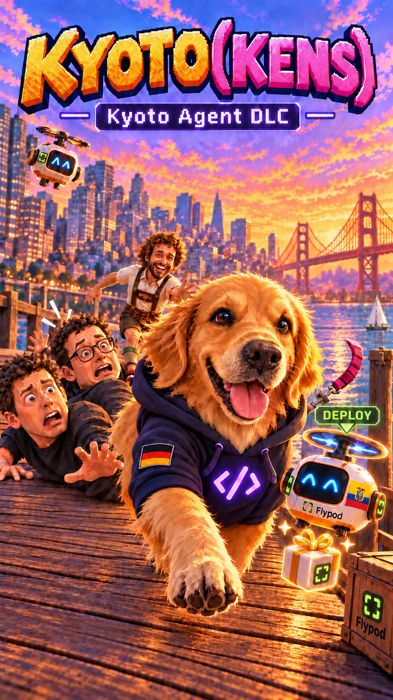

# Kyoto(kens) — Pacing the Frontier

<p align="center"></p>

A static, single-page Three.js browser game. You play Kyoto, a golden retriever let loose on a
stylized San Francisco: collect the **K Y O T O** letters, bark at agents, hack drones, chase the
CEO duo, snap 15 album photos, and surf out to Alcatraz.

There is **no build step** — the files in this repo are the shipped game. No server code, no
database. Non-commercial parody fan game.

**Play:** <https://claude.ai/artifact/Xt7w9RygtqKaSxX92AwrpS>

## Run locally

The game is plain static files, but it loads ES-free `<script>` tags and uses `fetch` for its
models, so it must be served over HTTP (opening `index.html` from the filesystem will fail).

```sh
python3 -m http.server 8765
```

Then open <http://localhost:8765>.

Any static file server works; the only requirement is that `.json` files are served with a sane
MIME type, which `python3 -m http.server` does.

### Silent run

Append `?mute=1` to start with all audio muted (handy for automated checks):

<http://localhost:8765/?mute=1>

## Controls

| Input | Action |
|---|---|
| `W` `A` `S` `D` (or arrows) | Move |
| `Shift` | Sprint |
| `Space` | Jump |
| `B` | Bark (scares pedestrians, stuns agents) |
| `Q` | Open the Kyotoken wheel, then `1`–`8` to deploy an ability |
| `E` / `Enter` | Interact with whatever is in front of you |
| `L` | Map |
| `Tab` | Photo album |
| `J` | Family album |
| `P` | Pause / resume |
| `Esc` | Close the open panel / release the mouse |
| Mouse drag | Look around |
| Click | Start the run; click prompts to act |

On touch devices a virtual stick, jump/bark buttons, and an action bar appear automatically.

## Kyoto Agent city update

Kyoto starts in a dark purple hoodie with the violet code emblem. Kyoto Agent ads use the
supplied icon and desk portrait separately. Oracle Park has a hero billboard and wall flyers;
a few more ads appear around the city. Japantown includes a Peace Pagoda, cherry trees,
shops, and a bronze Kyoto memorial thanking him for helping San Francisco against Godzilla.

**Flypod Fetch:** find five lime project folders, press `E` to fetch them, then bring them to
one of the friendly Flypod bots in Japantown or near Oracle Park and press `E` to deploy. Open the
map with `L` or tap the objective card: `F` marks folders and `D` marks deploy bots.
Completed projects earn 6,500 tokens in total. The savings are a fictional game score;
the quest makes no external deployments or claims about real hosting costs. A new run resets it.

Brand references: [Flypod docs](https://docs.flypod.dev/), [Flypod](https://flypod.dev/),
[Kyoto Agent](https://kyotoagent.dev/). The Flypod mark is the official favicon SVG, with
charcoal `#0b0f12`, lime `#b7f84a`, and ivory `#f2f4f7` from the live site stylesheet.
The two Kyoto reference images remain unchanged in `art/campaign/`.

**Kyoto Vision:** press `V` or click the eye button to switch the 3D world to a blue/yellow
approximation of dog colour vision. The preference persists between visits; the HTML HUD
retains its normal colours for readability. This is an artistic approximation, not a precise
simulation of canine perception. Sound, song and pause now have labelled icons and focus feedback.

The cover in `art/kyotokens-agent-cover-clean-v4.png` was edited with the built-in image generator.
The exact edit prompt is saved in `art/campaign/cover-clean-v4-prompt.txt`; the previous covers remain intact.
The cleaned cover removes the coins, ground capsules, inset map, rear Kyoto Agent billboard, two floating blue background props and green ground arrows. Kyoto and both drones remain, including the close Flypod and its blue rotor halo.

Local review scenes: `?scene=agenthoodie&mute=1`, `?scene=japantown&mute=1`,
`?scene=campaignstadium&mute=1`, and `?scene=flypodcheck&mute=1`.
The last scene checks collection distance, all five rewards, duplicate deployment, and restart.

## Folder map

```
index.html        entry point: markup, styles, and the ordered <script> list
src/              game code, loaded in order (core, world, actors, ui, music,
                  then feat_* feature modules, then main.js)
models/           hand-built low-poly city/character geometry as glTF .json bundles
assets/
  ext/            characters + manifest.json (which models the crowd may use)
  npc/            specific NPC model bundles (dog, worker, skateboarder, ...)
tex/              runtime textures (billboards, murals, magazines, fur, ground detail)
  assets/         Poly Haven-derived ground textures + LICENSES.md and the generator
  assets/src/     unmodified 1K Poly Haven sources (provenance only, not loaded)
photos/           album photos (photos/web/) plus the Alcatraz PNG
art/              CEO portraits and cut-out art, family postcards, sign art
```

## Assets and CDN

Three.js **r128** and the GLTFLoader / SkeletonUtils / BufferGeometryUtils examples load from
`cdn.jsdelivr.net`, and the display fonts (Bangers, Titan One, Nunito) load from Google Fonts.
Everything else — models, textures, photos, art — is a local static file in this repo.

Served assets are cache-busted with a single `?v=` string that matches `K.VER` in `index.html`;
bump both together when changing anything in `src/` or the texture set.
The cover sleeve has a sewn ribbed cuff with the foreleg exposed below it.

## Current release status

This version is published as-is at the user's request. The current hoodie clipping repair
received 4/5 from an independent Opus 5.5 High review; the remaining request was an
old-versus-new comparison of the exposed bandana above the neckline. This release is
not a claim of a perfect or fully approved DLC.

The accepted fast movement and dog rig remain unchanged. Original body geometry is
retained; a projected opaque-clothing stencil hides covered fur while preserving
exposed anatomy. Removing the hoodie restores the original geometry and materials.

### Canine animation attribution and reproduction

The walk/run motion uses selected AI4Animation SIGGRAPH 2018 dog motion-capture data
under **CC BY-NC 4.0**. This is a non-commercial game. Source attribution, selected
BVH takes, hashes and the reproducible authoring pipeline are in
[art/authoring/canine/ATTRIBUTION.md](art/authoring/canine/ATTRIBUTION.md).
The bundled Three.js authoring runtime retains its MIT notice.
